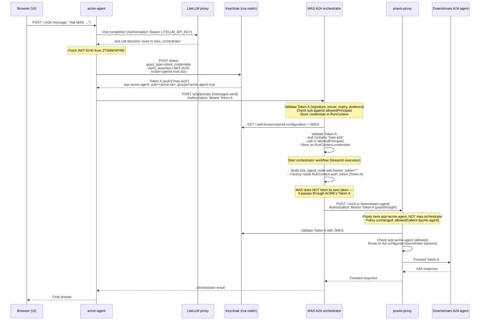
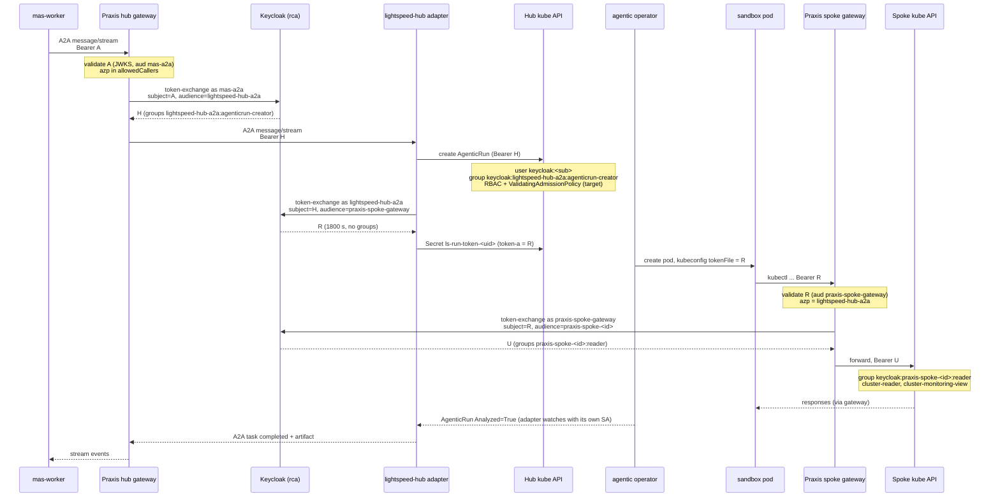

# Authentication flow: ACME UI to downstream agents

This documents the full per-request authentication path from a user typing a
message in the ACME agent's UI through to the MAS orchestrator and its
downstream A2A agents. There is one Keycloak grant and one passthrough hop
(ACME -> MAS -> Praxis) per request. When the downstream agent is the
**lightspeed-hub** (cluster investigations), three RFC 8693 token exchanges
follow, each minting a token for exactly the next hop (A -> H -> R -> U).
To watch a live request hop by hop — identities, each exchange, and on whose
behalf — run `bash scripts/monitor.sh` (see
[`scripts/README.md`](../scripts/README.md#flow-monitor)); the Keycloak
realm-event feed it uses (`--kc`) is the authoritative record of the
exchanges described below.

Visual companions:

- [`docs/agentic-architecture-overview.html`](../docs/agentic-architecture-overview.html):
  every component, the Keycloak clients and which token flows where.
- [`docs/agentic-e2e-token-flow.html`](../docs/agentic-e2e-token-flow.html):
  a step-by-step walkthrough of one investigation, showing per hop the token
  received, the checks, the client used, the exchange request and the token
  forwarded.

The design rationale for the exchange chain, and what belongs to the
lightspeed-agentic-operator versus the lightspeed-hub, is in
[`docs/GATEWAY_MODE_SCOPED_TOKEN_EXCHANGE.md`](../docs/GATEWAY_MODE_SCOPED_TOKEN_EXCHANGE.md).

## Two unrelated credential systems

It is easy to conflate these because both eventually show up as an
`Authorization` header somewhere, but they answer completely different
questions and must not be confused when debugging:

1. **LLM inference credentials.** ACME's local ADK coordinator (the router
   that picks a downstream sub-agent) always goes through LiteLLM
   (`LITELLM_API_KEY`/`LITELLM_API_BASE`) -- a **static, standing credential
   per deployment**, the same key for every request, unrelated to who's
   asking. It answers "how does ACME's own routing decision authenticate to
   its model backend", and has nothing to do with authorization. If this is
   broken, ACME can't decide anything at all -- it fails before ever
   delegating to MAS (see the `litellm.InternalServerError`
   / `Model ... not found` failures in Troubleshooting below, entirely
   independent of Keycloak/SPIFFE).
2. **Workload/caller identity tokens (SPIFFE JWT-SVID + Keycloak).**
   Everything else in this document. This is **dynamic and per-request**: it
   answers "which identity authorizes this specific call, on behalf of
   whom". ACME authenticates to Keycloak as *itself* (its own SPIFFE
   identity) to call the MAS A2A endpoint; MAS validates that token and
   passes it through unchanged to the orchestrator's delegated A2A calls,
   so every downstream hop is attributable to the ACME caller, not to MAS.
   Past MAS, the Praxis gateways and the lightspeed-hub adapter *exchange*
   it for narrower tokens, but every one keeps the same `sub`.

In short: the LiteLLM key decides *whether an agent can talk to its LLM at
all*; the SPIFFE/Keycloak chain decides *what the agent is allowed to do,
and as whom*. A failure in one never explains a failure in the other --
that's also why the diagram below draws the LiteLLM proxy as its own
participant instead of folding it into a `Note`.

## Sequence

### Orchestrated flow: ACME → MAS → downstream agents (token passthrough)

ACME delegates to a MAS orchestrator blueprint that calls downstream A2A
agents. MAS **validates and passes through** ACME's token — it never fetches
its own credentials.



**Key points:**
- MAS validates Token A but **does not exchange or rewrite it**
- MAS passes Token A through to `a2a_agent_node` via `RunContext.credentials`
- Praxis and the downstream agents see `azp=acme-agent`, never
  `mas-orchestrator`
- No changes to Praxis policy needed for the MAS hop
- MAS is **invisible** to the authentication chain
- For the lightspeed-hub agent, the Praxis **hub gateway** does not forward
  Token A: it exchanges it (next section)

### Hub investigation flow: MAS → lightspeed-hub → cluster APIs (token exchange chain)

Live since 2026-11-20 on the standalone variant. MAS's remote agent "Hub
Cluster Investigator" points at the Praxis hub gateway. From there, **each
token's audience is the client that exchanges or consumes it next**, so every
exchange asks for exactly one audience. That is required twice over: Keycloak
only lets a client exchange a token that names it in `aud`, and Praxis's
`delegate()` takes a single audience.

| Token | Minted by (client) | `sub` | `azp` | `aud` | `groups` | Life | Accepted by |
| --- | --- | --- | --- | --- | --- | --- | --- |
| **A** | Keycloak for `acme-agent` (SPIFFE) | caller | `acme-agent` | `mas-a2a` | `acme-agent-rca` | 300 s | MAS A2A, hub gateway |
| **H** | hub gateway, as `mas-a2a` | same | `mas-a2a` | `lightspeed-hub-a2a` | `lightspeed-hub-a2a:agenticrun-creator` | 300 s | adapter, hub kube API |
| **R** | adapter, as `lightspeed-hub-a2a` | same | `lightspeed-hub-a2a` | `praxis-spoke-gateway` | none | 1800 s | spoke gateway only |
| **U** | spoke gateway, as `praxis-spoke-gateway`, per call | same | `praxis-spoke-gateway` | `praxis-spoke-<id>` | `praxis-spoke-<id>:reader` | 300 s | spoke kube API |



**Key points:**

- The adapter never sees Token A, and A is useless past the hub gateway (it
  gets `401` at every kube API, as does R).
- The run is created **as the caller** (H), not as the adapter's
  ServiceAccount; the adapter's own SA only watches runs and manages the
  run-token Secret.
- R exists so a long investigation survives A's and H's 5-minute lifetime: an
  exchanged token takes the **exchanging client's** `access.token.lifespan`
  (1800 s on `lightspeed-hub-a2a`), even past the subject token's expiry.
  Beyond that, the adapter parks the A2A task in `auth-required`; MAS replies
  with a fresh A, which becomes a fresh H and R.
- An exchanged token's `azp` is the **exchanging** client. So the spoke
  gateways allow-list `lightspeed-hub-a2a` (`spokeGatewayConfig.allowedCallers`),
  not `acme-agent`.
- Kubernetes tells run creation (H) and investigation reads (U) apart by
  group, because each exchanger projects audience-scoped client roles into
  `groups` (`charts/all/keycloak-oidc` `exchangeRoles`).
- In gateway credential mode the agentic operator creates no spoke
  ServiceAccount and no spoke-management kubeconfig: every read is made as
  the caller, through the spoke gateway.

**Credential renewal across MAS and the hub.** No refresh tokens are
involved: ACME re-authenticates for a fresh A, and H, R and U are re-derived
from it.

- MAS checks a credential's remaining validity before each graph node
  (default minimum 60 s) and, when it is too short or a downstream call
  returns 401/auth-required, opens a renewal request in its Mongo mailbox.
  The worker waits inside the same Temporal activity (heartbeats continue);
  the inbound A2A side shows the outer task as `AUTH_REQUIRED` to ACME.
- ACME answers on the **same task**, with a new `message_id` and a fresh
  Authorization. MAS stores the sealed replacement and the waiting node
  continues: no new workflow, no second submit, completed nodes are not
  re-run.
- 401 and `AUTH_REQUIRED` differ: a 401 before the request was accepted
  means resend with fresh credentials; a downstream task already in
  `AUTH_REQUIRED` gets a credential-only follow-up on that task. A 403 is a
  denial, never a renewal trigger, and fresh credentials do not revive
  terminal tasks or bypass approvals.
- On the hub, the adapter parks its task in `auth-required`; the fresh A
  arrives through the hub gateway as a fresh H, which the adapter exchanges
  for a fresh R written to the same `ls-run-token-<uid>` Secret. The sandbox
  reads `tokenFile` per request, so it picks up the new R in place. Seen
  live: `task paused for credential renewal` then `renewed run credential`
  five seconds later.
- Renewal is not exactly-once execution: a worker crash can retry an
  in-flight activity, and a command may have changed the cluster before its
  response was lost. Only a known pre-dispatch auth rejection is a safe
  retry.
- Open: steps that outlive one R (30 min), especially behind long approvals.

## Praxis policy mode (standalone: policy enforcement)

Praxis has two modes, selected by `policy.enabled` (default `true`) in
`charts/all/praxis-proxy`:

- **`policy.enabled: true` (default, and now what the `standalone` variant
  sets):** Praxis runs its `policy` filter — it validates the caller JWT against
  the configured trusted issuers/JWKS **and** enforces the `claim.azp` allow-list
  (`policy.allowedCallers`) before routing, and the `enforcement-check-job`
  PostSync check asserts it denies a non-allow-listed caller. This is the mode
  every mermaid sequence and troubleshooting entry in this document describes.

- **`policy.enabled: false` (router-only):** the `policy` filter is skipped
  entirely (`charts/all/praxis-proxy/files/praxis.yaml` wraps the
  `- filter: policy` block in `{{- if .Values.policy.enabled }}`, and the
  `enforcement-check-job` PostSync check is skipped too). Praxis becomes a
  **pure router/load-balancer**: it does **no** caller JWT verification and
  enforces **no** `azp` allow-list; it only routes to the configured backend.
  Use this only where a downstream boundary validates instead.

**Enabling policy enforcement on this IPv4-only cluster.** Standalone now runs
`policy.enabled: true`. Two concrete blockers previously forced router-only, both
now handled (see `charts/all/praxis-proxy/README.md`, "Policy enforcement on
IPv4-only clusters"):

1. **Caller allow-list.** A Red Hat SSO caller token is issued by an external
   issuer with `azp` = ACME's confidential SSO client, not `acme-agent`, so the
   `azp` allow-list would reject it. Fixed by adding that SSO client's `azp` to
   `policy.allowedCallers` alongside `acme-agent`.
2. **External JWKS fetch over IPv4.** The pinned Praxis image's Rust HTTP client
   resolves the external SSO hosts to **IPv6** and does not fall back to IPv4;
   this cluster has IPv4-only egress, so Praxis's own JWKS fetch for
   `sso.redhat.com`/`sso.stage.redhat.com` failed (`ConnectNoRoute` / `Network
   unreachable`). The image is Alpine/musl, so the glibc `options no-aaaa`
   resolver switch does not apply. Fixed with the `dnsIPv4Only` CoreDNS sidecar
   (strips AAAA; the pod resolves through it via `dnsPolicy: None`, so the client
   only ever receives A records), plus `policy.caBundleSync.includeSystemRoots=true`
   so Praxis's `SSL_CERT_FILE` bundle — which *replaces* the default trust store —
   also trusts the public SSO chain, not just the Keycloak ingress CA. Verified
   live from the Praxis pod: the default resolver returns A+AAAA, the sidecar
   returns A only, in-cluster names still resolve, and the SSO JWKS loads over
   the public roots. (Keycloak, which caches external-IdP keys, never hit the
   IPv6 problem — only Praxis's Rust client does.)

**Security posture.** With the policy filter on, Praxis validates every caller
token (issuer/JWKS/audience) and denies any caller whose `azp` is not in
`policy.allowedCallers` — so reaching a downstream backend requires both an
allow-listed `azp` and a token the downstream trusts, not merely "any
validly-signed token from anyone who can reach the public Route." Keep the
per-issuer audiences tight (`api.ask_red_hat` for the Red Hat SSO issuers,
`mas-a2a` for the local Keycloak issuer) and the `allowedCallers` list minimal.

## ACME IdP selection and token debugging

ACME's outbound Token A can now be minted from either the local Keycloak realm
or Red Hat SSO production/stage. The choice is **request-scoped**, not a
process-global setting: the embedded UI sends
`X-ACME-Auth-Provider`, `X-ACME-Auth-Environment`, and
`X-ACME-Auth-Token-Type`; ASGI middleware validates and binds those values to
a `ContextVar`; and the shared outbound `httpx` client reads that context when
it attaches `Authorization`. Concurrent browser conversations can therefore use
different providers without cross-contaminating one another.

The current Red Hat IdP implementation supports only the **agent token**
(`grant_type=client_credentials`). ACME uses a confidential Red Hat SSO client
ID and secret, both injected through an ExternalSecret. It does **not** exchange or
rewrite that token: MAS receives it as Token A, validates its issuer/audience
and principal, and passes it through unchanged. The Red Hat SSO client must be
allowed to obtain the downstream audience (`api.ask_red_hat` in the standalone
configuration), and its service-account principal must be added to MAS's
`a2a.allowedPrincipals`. That principal is the token's opaque `sub`, which can
differ from both `azp` and the OAuth client ID in the external secret.

The UI presents a user-token choice for planning purposes, but selecting it is
rejected before the agent runs. **TODO:** implement Red Hat IdP user login with
authorization-code flow plus PKCE, registered redirect URIs, CSRF/state
validation, a per-user token cache keyed by the browser session, and downstream
validation identical to the agent-token path. The confidential client remains
server-side; its secret must never be exposed to the browser.

For debugging, `auth.tokenDebug.enabled=true` lets the UI generate a private,
unguessable nonce and retrieve the outbound bearer token once from
`/ui/auth/token/<nonce>` within `AUTH_TOKEN_DEBUG_TTL_SECONDS`. The response is
`Cache-Control: no-store`, the entry is deleted on first retrieval, and the
nonce is deliberately different from the logged `X-Request-Id`. The resulting
UI section is collapsible and has a copy button. Disable token debug when not
actively inspecting a token.

**Gotcha:** an SSO `A2A` failure shown only as an ADK agent-card `HTTP 401`
is often the SSO token mint, not the card. If the token endpoint says
`Client not enabled to retrieve service account`, enable that client's
`client_credentials` grant in the external registration; ACME now surfaces the
OAuth `error_description`.

## Keycloak <-> OpenShift group mapping (pre-provisioned, not per-request)

The API server never calls Keycloak "live" to ask whether a token is
authorized -- everything below is configured once by `charts/all/keycloak-oidc`
and then only read from cache on the hot path:

1. **Trust**: `Authentication/cluster`'s `spec.oidcProviders[0]` (rendered by
   `templates/openshift-authentication.yaml`) names Keycloak's realm issuer
   URL and fetches/caches its JWKS for signature verification. Any audience a
   token was issued for must be listed in `issuer.audiences`
   (`keycloak.clientId`, `keycloak.consoleClientId`, plus
   `openshiftOIDC.extraAudiences`).
2. **Claim mapping**: `claimMappings.groups.claim` (`openshiftOIDC.groupsClaim`,
   default `groups`) tells the API server which token claim carries group
   membership, and `claimMappings.groups.prefix` (`openshiftOIDC.groupsPrefix`,
   default `keycloak:`) is prepended to every value. The `groups` claim itself
   only appears in a token if the *client that issued it* has a `groups`
   protocol mapper attached -- there is no realm-wide default, which is
   exactly the console/CLI gotcha in Troubleshooting below.

   The prefix is deliberate, not cosmetic: an **empty** prefix would let a
   Keycloak-sourced group value collide with a Kubernetes **reserved
   `system:`-namespaced group** (e.g. `system:masters` grants cluster-admin)
   if a group in Keycloak was ever named that, by mistake or otherwise.
   `keycloak:` makes that structurally impossible -- no claim value coming
   through this path can ever produce a bare `system:...` group name. Don't
   remove it to match examples that use an empty prefix.

   With `exchangeRoles`, the exchanged tokens H and U also carry
   audience-scoped client roles as `<client>:<role>` group values, so the
   API server sees `keycloak:lightspeed-hub-a2a:agenticrun-creator` for H
   and `keycloak:praxis-spoke-<id>:reader` for U. Kubernetes RBAC binds
   groups, not audiences, so this is how run creation and investigation
   reads get different permissions for the same `sub`.

3. **RBAC**: bindings such as `admin-rbac.yaml`'s
   `<adminGroupName>-cluster-admin` `ClusterRoleBinding` target
   `Group:keycloak:<adminGroupName>` directly. There is no separate
   OpenShift `User`/`Group` object to provision -- the prefixed claim value
   *is* the RBAC subject the moment a valid token presents it.

The one manual, one-time step this doesn't template (Keycloak-version-specific
UI, see `charts/all/keycloak-oidc/README.md`): creating the actual Keycloak
group (e.g. `cluster-admins`) and adding users to it. Everything downstream of
that -- the claim appearing in tokens, the API server trusting it, and RBAC
resolving it -- is what steps 1-3 above wire up automatically.

External OIDC brokered users are different: Keycloak does not automatically
put them in a local realm group when it exchanges their external token. Each
`keycloak.externalOidcProviders[]` entry therefore supports
`hardcodedGroups` (the standalone values use `acme-agent-rca` for both Red Hat
SSO environments). A fresh realm import renders a `Hardcoded Group` IdP
mapper; on an already-imported realm, `realm-secrets-reconciler-job.yaml`
matches the provider by issuer URL and creates or updates that mapper. The
mapper must run before the **next** token mint -- an already-issued token does
not retroactively gain a group claim.

## The Keycloak clients

Defined by `charts/all/keycloak-oidc`, in the `rca` realm. Conflating any of
these breaks the flow -- see that chart's README for the exact rationale.

| Client | Type | Used by | Purpose |
| --- | --- | --- | --- |
| `openshift-cli` | public | Browser / `oc login` | Native OIDC login only, unrelated to the agent request flow. Registered as the `cli` OIDC platform client. Cannot authenticate itself. |
| `openshift-console` | confidential | Web console | Registered as the `console` OIDC platform client. Needs the `groups` protocol mapper (see Troubleshooting) or RBAC group membership never reaches the console. |
| `acme-agent` | confidential | acme-agent | Client-credentials-style grant authenticated with acme-agent's own SPIFFE JWT-SVID (`client_assertion_type=urn:ietf:params:oauth:client-assertion-type:jwt-spiffe`) instead of a static secret. Its service account belongs to the `acme-agent-rca` group, so its tokens carry a `groups` claim RBAC can key on. Only audience: `mas-a2a`. `fullScopeAllowed: false`, so Keycloak's audience-resolve cannot add other clients' audiences. |
| `mas-a2a` | confidential, exchange only | Praxis hub gateway | Token A's audience (MAS validates it) **and** the hub gateway's exchanger: A -> H, audience `lightspeed-hub-a2a`. Secret `praxis-hub-exchange-client` (Vault `praxis-hub-exchange`, alphanumeric). `keycloak.hubGatewayExchanger`. |
| `lightspeed-hub-a2a` | confidential, exchange only | lightspeed-hub adapter | H's audience (the hub kube API accepts it) and the adapter's exchanger: H -> R, audience `praxis-spoke-gateway`. `access.token.lifespan` 1800 s gives R its lifetime. Client role `agenticrun-creator` lands in H's `groups`. `keycloak.hubExchange`. |
| `praxis-spoke-gateway` | confidential, exchange only | Praxis spoke gateways | R's audience and the spoke gateways' exchanger: R -> U, audience `praxis-spoke-<id>`. Secret `praxis-spoke-gateway-client` (Vault `praxis-spoke-gateway`, alphanumeric). `keycloak.spokeGatewayExchanger`. |
| `praxis-spoke-<id>` | audience only | spoke kube APIs | U's audience, one per spoke. Exists because a token-exchange `audience` must name an existing client (`400 Audience not found` otherwise). Client role `reader` lands in U's `groups`. |

`mas-a2a` used to be a plain custom audience string with no client behind
it. It became a client when the hub gateway started exchanging Token A,
because Keycloak only lets a client exchange a token whose `aud` names it.
The retired `lightspeed-hub-adapter` client (the adapter's exchanger before
the hub gateway took over A -> H) is not rendered any more.

`acme-agent` authenticates via Keycloak's federated
client authentication feature against the `spiffe` identity provider this
chart also creates -- fully declarative
(`keycloak.spiffeIdentityProvider.*`/`clientAuthenticatorType: federated-jwt`
in `charts/all/keycloak-oidc`), no manual Admin Console step required. See
that chart's README for the exact mechanics, including two non-obvious
requirements this doc's Troubleshooting section below also covers: the
`client_id` form parameter must be omitted from these requests, and the
SPIFFE JWT-SVID used as `client_assertion` must be requested with the
Keycloak realm issuer URL as its audience, not the workload's own name.

## Per-hop identity and validation

Every JWT sample below is illustrative -- field names and the exact claim set
depend on this realm's protocol mappers, not a spec all Keycloak realms share
-- but the shapes match what this repo's charts actually configure. Watch
`sub`/`azp`/`aud` hop to hop; that's the whole "who, calling what, on whose
behalf" story in one column.

1. **User to acme-agent**: no authentication by default (`auth.mode` on
   the caller-facing side is out of scope here -- this doc covers the
   *downstream* auth acme-agent performs, not who's allowed to open the
   UI). No token exists yet, which matters below: nothing upstream of step 3
   ever identifies the human at the keyboard.
2. **acme-agent to LiteLLM** (`agents/acme_agent/src/acme_agent/agent.py`,
   `_model()`): every reasoning step of the local ADK coordinator (including
   the decision to route to `mas_orchestrator`) goes through
   `LiteLlm(base_url=..., api_key=...)`, populated from
   `LITELLM_API_BASE`/`LITELLM_API_KEY` -- a static credential from
   acme-agent's own `litellm.credentialsSecretName` Secret, unrelated to the
   caller and to steps 3-4 below.

   ```
   Authorization: Bearer sk-litellm-REDACTED
   ```

   Opaque, not a JWT -- there is nothing to decode. This key identifies the
   *deployment*, not any caller; the same value is sent for every request.
3. **acme-agent to MAS** (`agents/acme_agent/src/acme_agent/auth.py`,
   `DownstreamAuth`): fetches a JWT-SVID from the SPIFFE Workload API for
   audience `identity.keycloak.issuerUrl` (the Keycloak realm issuer --
   *not* `acme-agent`; see Troubleshooting), uses it as `client_assertion`
   in a Keycloak `client_credentials` token request for the confidential
   `acme-agent` client (with no `client_id` form parameter -- also see
   Troubleshooting), and attaches the resulting access token as
   `Authorization: Bearer` on every outbound A2A request (`httpx`
   `event_hooks`).

   Real captured shape (live mint from `acme-agent`; hostnames redacted;
   `groups` confirmed present):

   ```json
   {
     "iss": "https://keycloak.apps.<cluster-domain>/realms/rca",
     "sub": "57cf7fc8-6db4-4a3e-bec4-d109386e1133",
     "azp": "acme-agent",
     "aud": ["mas-a2a"],
     "groups": ["acme-agent-rca"],
     "scope": "email profile",
     "typ": "Bearer"
   }
   ```

   **This is the token that is passed through for the rest of the
   chain.** Because step 1 authenticates no one, `sub` here is
   acme-agent's own service account, not the human using the UI --
   everything downstream is attributable to acme-agent-as-caller, not to
   an end user. Note `sub` is an opaque internal user id, not the readable
   `service-account-acme-agent` string (that only appears in
   `preferred_username`). If per-user attribution is ever needed, a user
   identity has to be captured before this hop and folded into this token.
   `mas-a2a` appears in `aud` because MAS's inbound check needs it and
   because client `mas-a2a` (the hub gateway's exchanger) must find itself
   there to exchange the token (`keycloak.masA2aAudience`, an audience
   protocol mapper on the `acme-agent` client, see
   `charts/all/keycloak-oidc`).
4. **MAS validates the inbound token** (the MAO A2A endpoint's multi-issuer
   OIDC middleware): verifies the RS256 signature via the issuer's JWKS,
   exact issuer, `mas-a2a` audience, and token lifetime/subject, then checks
   `sub` (or `user_id`) exactly against `a2a.allowedPrincipals`. A missing or
   invalid token returns `401`; a valid token from a non-allow-listed
   principal returns `403`. MAS is multi-issuer (local Keycloak **plus** Red
   Hat SSO prod/stage), each with its own JWKS and audience. Task reads and
   mutations are scoped to that principal.

   The orchestrator then passes the same bearer through unchanged on every
   delegated A2A call (`a2a_agent_node` with an empty `bearer_token` reads
   `RunContext.auth_token`), so downstream services (Praxis and anything
   behind it) still see `azp=acme-agent`, never a MAS identity.
5. **Praxis hub gateway** (`charts/all/praxis-proxy`,
   `a2aUpstream.exchangeAtPraxis`): validates A (signature, issuer, audience
   `mas-a2a`, `azp` in `policy.allowedCallers`), then
   `delegate(hub-delegator, target: hub-adapter, audience: lightspeed-hub-a2a)`
   as client `mas-a2a` (HTTP Basic). Forwards **H**:

   ```json
   { "sub": "<same>", "azp": "mas-a2a", "aud": "lightspeed-hub-a2a",
     "groups": ["lightspeed-hub-a2a:agenticrun-creator"] }
   ```
6. **lightspeed-hub adapter** (`charts/all/lightspeed-hub`,
   `adapter.inboundHubToken`): creates the AgenticRun with H. The hub kube API
   (OpenShift Native OIDC) sees user `keycloak:<sub>` in group
   `keycloak:lightspeed-hub-a2a:agenticrun-creator`, which RBAC allows to
   create runs and the ValidatingAdmissionPolicy checks against the run's
   target. The adapter then exchanges H as `lightspeed-hub-a2a`
   (`adapter.runTokenAudience`) and stores **R** in `ls-run-token-<uid>`:

   ```json
   { "sub": "<same>", "azp": "lightspeed-hub-a2a", "aud": "praxis-spoke-gateway" }
   ```
7. **Sandbox** (lightspeed-agentic-operator, gateway credential mode): its
   kubeconfig points at `https://praxis-spoke-<id>.praxis-proxy.svc:8443`
   with `tokenFile: /var/run/secrets/run-identity/token-a` (R).
8. **Praxis spoke gateway** (`spokeGateways.<id>`): validates R (audience
   `praxis-spoke-gateway`, `azp` in `spokeGatewayConfig.allowedCallers`), then
   per call `delegate(spoke-delegator, target: spoke-api, audience: praxis-spoke-<id>)`
   as `praxis-spoke-gateway`. Forwards **U** to its one fixed spoke API:

   ```json
   { "sub": "<same>", "azp": "praxis-spoke-gateway", "aud": "praxis-spoke-hub",
     "groups": ["praxis-spoke-hub:reader"] }
   ```
9. **Spoke kube API**: user `keycloak:<sub>`, group
   `keycloak:praxis-spoke-<id>:reader`, bound to `cluster-reader` and
   `cluster-monitoring-view` (`charts/all/lightspeed-hub` `spokeReaderRBAC`).

## Tracing a live request

Each hop fails independently and mostly silently (generic `401`s are
deliberate), so trace hop-by-hop rather than end-to-end:

```bash
# 1. acme-agent's outbound call and its own SPIFFE fetch
oc logs -n acme-agent -l app.kubernetes.io/name=acme-agent -f

# 2. Praxis ingress authorization and routing -- a deny or a
#    routing-to-the-wrong-backend decision here means the downstream agent
#    never received the request at all
oc logs -n praxis-proxy -l app.kubernetes.io/name=praxis-proxy -f

# 3. Keycloak's own record of every grant against a client --
#    enable this once: Admin Console -> Realm Settings -> Events -> Save Events
#    then Realm -> Sessions / Events, filtered by client (acme-agent)

# 3b. Hub investigation chain: adapter (run submitted, run-token stored),
#     spoke gateway (403 = azp allow-list; 401 = token validation), operator
oc logs -n lightspeed-hub deploy/lightspeed-hub | grep '^{'
oc logs -n praxis-proxy deploy/praxis-spoke-hub -c praxis-spoke-gateway | grep -E 'WARN|ERROR'
oc logs -n lightspeed-hub deploy/lightspeed-hub-agentic-operator | grep -v DEBUG
#     decode the stored run token's claims (never print the token itself):
oc get secret -n lightspeed-hub ls-run-token-<uid> -o jsonpath='{.data.token-a}' \
  | base64 -d | cut -d. -f2 | base64 -d 2>/dev/null | jq '{aud, azp, groups, exp, iat}'

# 4. What the API server currently trusts
oc get authentication.config.openshift.io cluster -o jsonpath='{.spec.oidcProviders[0].issuer.audiences}'

# 5. Whether RBAC is why a call was denied (impersonation pre-check,
#    not a substitute for inspecting a real token's claims --
#    see charts/all/keycloak-oidc/README.md's "End-to-end verification")
oc auth can-i get pods --as=nobody --as-group=keycloak:acme-agent-rca -n <namespace>
```

To follow a *single* request, join on the request id: ACME logs one
`acme_audit request_id=... actor=acme-agent ...` line per outbound call.
Grep the ACME log for the id (the line never contains a token):

```bash
oc logs -n acme-agent -l app.kubernetes.io/name=acme-agent | grep "acme_audit" | grep "<request_id>"
```

**The join does not cross MAS.** Each MAS stage mints its own
request id and ACME's `X-Request-Id` never reappears downstream -- observed
live: the MAO A2A endpoint's middleware logged its own dashed-UUID id for an
inbound POST. Trace the orchestrated flow by time window
instead -- `scripts/monitor.sh` timestamps every card for exactly this --
or across hops by the caller's `sub` (identical in A/H/R/U, printed on every
exchange card) and the token `fp:...` fingerprint, or by Keycloak Realm
Events, which record each grant regardless of header propagation -- the
monitor's `--kc` feed reads exactly those events.

## Separate trust boundary: inbound MAS A2A (with token passthrough)

The optional `mao-a2a` Application is registered but its chart defaults to
`a2a.enabled: false`, rendering no resources. Once deliberately activated,
MAS A2A runs as a separate `uie-mas-hosted` service, not through the
HCC-facing Flask API, Praxis, or ACME.

### Passthrough authentication design

MAS A2A **validates and retains** the inbound bearer token, then **passes it
through** to downstream A2A agents in the orchestrator blueprint. It does
**not** use its own SPIFFE grant or act as an independent workload identity.

**Flow example: ACME → MAS → downstream agent**

1. ACME fetches a JWT-SVID (SPIFFE), calls Keycloak with
   `grant_type=client_credentials + client_assertion`, gets Token A with
   `aud=["mas-a2a"]`.

2. ACME calls MAS A2A with `Authorization: Bearer <Token A>`.

3. MAS validates Token A (signature, issuer, expiry, audience, principal
   allow-list), then **stores it in `RunContext.credentials`**.

4. MAS starts orchestrator workflow, which includes an `a2a_agent_node` with
   `bearer_token: ""` (empty).

5. The `a2a_agent_node_factory` detects empty `bearer_token`, reads
   `build_ctx.execution_ctx.auth_token` (Token A from step 3), and uses it
   for the outbound call to Praxis / the downstream agent.

6. Praxis validates Token A (sees `azp=acme-agent`), routes to the
   configured downstream backend.

**From Praxis's and the downstream agents' perspective, MAS is invisible** —
they only see ACME's token (Token A), with `azp=acme-agent` and
`sub=<acme-sa>`. The existing Praxis policy
(`allowedCallers: [acme-agent]`) remains unchanged.

### Authentication validation

In Keycloak mode, MAS validates the JWT signature against Keycloak JWKS and
checks the configured issuer, lifetime, and audience. The chart refuses an
enabled Keycloak deployment without a non-empty
`identity.keycloakAudience`. MAS then checks the validated `user_id` (if
present) or `sub` **exactly** against `a2a.allowedPrincipals` (or the
configured Secret containing that list); it does not authorize by groups.
A Keycloak user's subject is usually an opaque `sub`, not their email or
username. A missing/invalid token returns 401; a valid token from a
non-allow-listed principal returns 403. Task reads and mutations are scoped
to that principal.

### Audience configuration

The A2A chart's configured `identity.keycloakAudience` must match the
caller's token. It refuses known OpenShift reserved audiences
(`openshift`, `openshift-cli`, `openshift-console`) when they appear as the
**sole** MAS audience; add customized equivalents to
`identity.forbiddenAudiences`.

JWKS retrieval and outbound A2A calls use verified HTTPS. A private Route CA
must be trusted by each MAS component making the request, alongside the
default public roots, not by disabling TLS verification. This includes
`mas-api`/`mas-worker` when they resolve or call A2A nodes and `mas-a2a` when it
does so. The standalone variant copies the managed-ingress CA into
`mao/keycloak-oidc-ca`; set the MAS charts' `identity.keycloakCaTrust.enabled`
to mount and append that CA even when the API/worker identity provider is
`dev`. Their init containers build `SSL_CERT_FILE` from public/system roots
plus that CA. CA rotation requires a MAS pod rollout to rebuild the bundle;
verify the target Route certificate on a live cluster before relying on it.

Separately, the public MAS API still needs its own production identity mode,
API-specific audience, and real admin usernames; the A2A allow-list does not
secure that Route.

MAS uses MongoDB for A2A task/context records and a Redis channel shared
with its Temporal worker for streaming and human-in-the-loop decisions.
`INPUT_REQUIRED` is a non-terminal task state. Reply to the **same
`task_id`** using a **new `message_id`**: a structured decision `DataPart`
supports `approve`, `reject`, `modify`, or `redirect`; plain text supports
leading `approve`/`yes` or `reject`/`no`/`deny` only. Reattach/subscribe to
the active task stream after replying so the next worker event clears the
pending state. `GetTask` polling alone may keep reporting `INPUT_REQUIRED`
until that reattachment or the approval gate's timeout. See the
[`mas-a2a` chart guide](../charts/all/mao/mas-a2a/README.md) and upstream
`uie-mas-hosted/docs/a2a-inbound.md` for the protocol details. None of this
has been validated on a live deployment of this Pattern.

## Troubleshooting

Symptom -> cause, for bugs actually hit while building this. Long-form write-ups
(how it was hit, why nothing caught it) are in
[`docs/LESSONS_LEARNED.md`](../docs/LESSONS_LEARNED.md).

- **`litellm.InternalServerError: ... Missing credentials`, or `Model
  openai/... not found`**: LLM-inference credential, not the identity chain.
  `LiteLlm` forwards `**kwargs` to `litellm.completion()` and does not read
  `LITELLM_API_BASE`/`LITELLM_API_KEY`; pass `base_url=`/`api_key=` (not
  `api_base`) explicitly.
- **Console/CLI users authenticate but land in no RBAC groups**: the
  `openshift-console` client needs its own `groups` mapper; adding it only to
  `openshift-cli` is not enough.
- **`Agent card URL must use https, or http on a loopback host`**: google-adk
  refuses plain HTTP to a non-loopback host; point ACME at the Praxis/agent
  TLS Route, not an in-cluster Service name.
- **401 from Keycloak `/token` while fetching a card**: the card fetch is
  unauthenticated, but ACME's httpx hook attaches its bearer token to every
  request -- this is the `client_credentials` + JWT-SVID grant failing.
  Reproduce against the token endpoint inside the pod. Known causes (all
  fixed): SPIFFE IdP created with `config.trustDomain` instead of
  `config.issuer` (`Invalid trust domain name`); SPIFFE IdP missing from the
  realm (`Invalid client or Invalid client credentials`); a `client_id` form
  parameter sent alongside `client_assertion` (`client_id parameter does not
  match sub claim`); JWT-SVID requested with the workload name instead of the
  realm issuer as audience.
- **A 401/403 downstream that used to work**: check `praxis-proxy` first.
  Confirm `policy.allowedCallers` contains the token's `azp`, the issuer and
  audience match (`identity.keycloak.audience` is `mas-a2a`, not an old
  `rca-agent` value), and Praxis can fetch JWKS. `UnknownIssuer` is TLS trust
  (`policy.caBundleSync`); `no public address` / private-address errors are
  the egress guard (`policy.allowPrivateIdp`, static issuers only).
- **Praxis admits every caller despite `policy.allowedCallers`**: pinned-image
  defect, not config. Only `role: user` plus an explicit `deny(...)` on the
  negated `claim.azp` check works; `role: client` populates claims the engine
  cannot see, bare predicates are no-ops, and `require(...)` denies
  unconditionally. The `enforcement-check` PostSync Job guards a regression.
- **`claim.azp` appears undefined although the token has it**: different,
  fixed bug -- the claim mapper's `client_id` field is not visible to route
  predicates on this build. Compare raw `claim.azp` with `role: user` +
  `read_claims`.
- **`CERTIFICATE_VERIFY_FAILED: unable to get issuer certificate`**: a CA
  bundle passed as `cafile=`/`verify=` *replaced* the system roots. Extend
  them instead (`create_default_context()` then `load_verify_locations()`).
  Not a bug in the CA-sync scripts, which only talk to the in-cluster API.
- **Red Hat SSO tokens fail Keycloak 26.4 exchange / userinfo 403**: request
  `openid api.ask_red_hat` (userinfo 403 otherwise). For the exchange
  itself, send `subject_token_type=urn:ietf:params:oauth:token-type:jwt`
  (the hub gateway's external delegator does): Keycloak then locates the
  IdP from the token's own `iss` claim -- no `subject_issuer` parameter,
  which no Praxis delegator config field can carry.
- **Token exchange `400 invalid_client "Audience not found"`**: every exchange
  audience must be an existing client (audience-only clients).
- **Token exchange refused although the subject token is valid**: the
  exchanging client must be in the subject token's `aud`.
- **`unauthorized_client: Unexpected error when authenticating client`**
  (Keycloak event `clientId="null"`): a `%` in a Praxis-presented secret
  (delegator Basic auth is not URL-encoded); all such secrets use
  `alphaNumericPolicy`.
- **Every sandbox `kubectl` call gets 403 "not an allow-listed caller"**: R's
  `azp` is the exchanger (`lightspeed-hub-a2a`), not `acme-agent`; set
  `spokeGatewayConfig.allowedCallers`.
- **Investigations die about 5 minutes in**: the run stored Token A; it now
  stores the exchanged run token R (1800 s).
- **Token A carries kube API audiences it never asked for**: `fullScopeAllowed`
  must be `false` on `acme-agent` (audience resolve).
- **Successful external login still fails RBAC as `User "keycloak:<uuid>"`**:
  no `groups` claim; add the external IdP's `hardcodedGroups` mapper and repeat
  the request with a fresh token.
