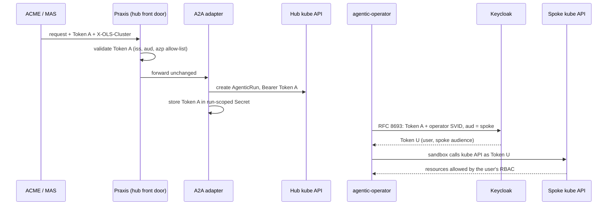
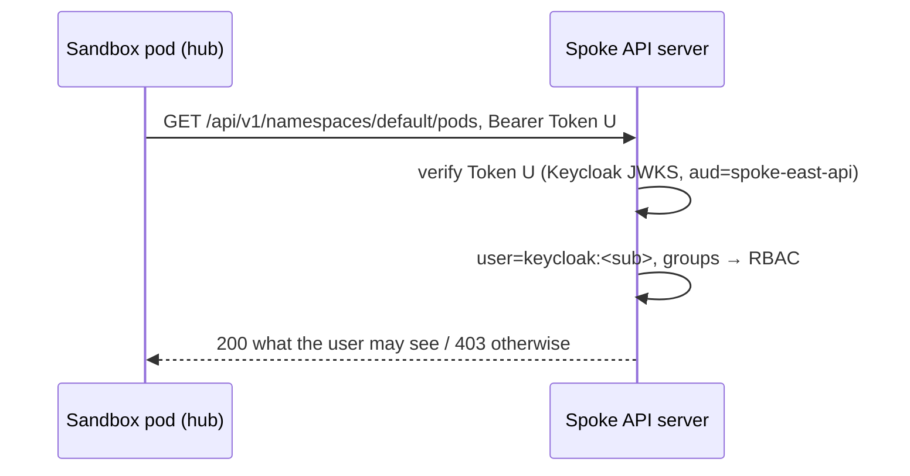
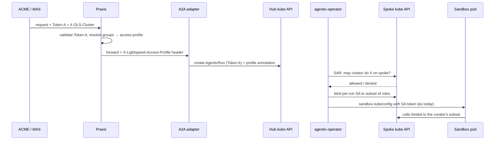
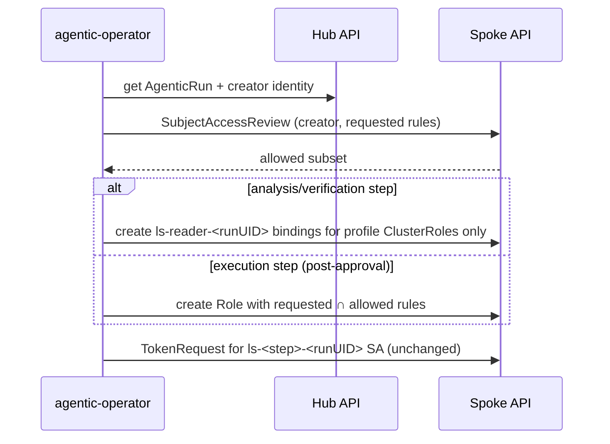

# Per-user identity in lightspeed-hub: two design options

This document designs how the [openshift/lightspeed-hub](https://github.com/openshift/lightspeed-hub)
+ [lightspeed-agentic-operator](https://github.com/openshift/lightspeed-agentic-operator)
stack could carry **the caller's identity to the spoke clusters**, in the same
spirit as the existing ACME → Praxis → OLS chain (see
[agents/AUTHENTICATION.md](../agents/AUTHENTICATION.md) and
[docs/ARCHITECTURE.md](ARCHITECTURE.md)).

It is written in the same stage-by-stage style as
<https://dkypuros.github.io/multicloud-gitops-design/>, which documents the
current pattern. Diagrams describe **proposed** designs against the upstream
code as of early Nov 2026.

## Status (2026-11-20): Option B implemented, in a different shape

This is the original proposal, kept for its reasoning and for Option C.
**Option B was implemented and is live** on the standalone cluster, but the
exchanges moved out of the agentic-operator and into the Praxis gateways and
the A2A adapter. The current design is
[`GATEWAY_MODE_SCOPED_TOKEN_EXCHANGE.md`](GATEWAY_MODE_SCOPED_TOKEN_EXCHANGE.md);
per-hop details are in [`agents/AUTHENTICATION.md`](../agents/AUTHENTICATION.md),
with diagrams in [`agentic-architecture-overview.html`](agentic-architecture-overview.html)
and [`agentic-e2e-token-flow.html`](agentic-e2e-token-flow.html).
Option C was not pursued.

| Topic | Proposed here | Implemented |
| --- | --- | --- |
| Caller token at the hub | Praxis validates Token A (`aud lightspeed-a2a`) and forwards it unchanged | Praxis **hub gateway** validates A (`aud mas-a2a`) and exchanges it as client `mas-a2a` for **H** (`aud lightspeed-hub-a2a`); the adapter never sees A |
| Routing | `X-OLS-Cluster` header selects the hub | one fixed upstream (the adapter); the adapter resolves the target from the `X-Hub-Cluster` header or the message's `targetCluster` metadata into `spec.targetCluster` |
| Run creation (B2) | adapter creates the AgenticRun with A | adapter creates it with **H**: user `keycloak:<sub>`, group `keycloak:lightspeed-hub-a2a:agenticrun-creator`, plus a ValidatingAdmissionPolicy on the target |
| Run-scoped Secret | `ls-run-token-<uid>` holds A | holds the run token **R** (adapter exchanges H as `lightspeed-hub-a2a`, `aud praxis-spoke-gateway`, 1800 s), key `token-a`; deleted after the terminal grace period |
| Where A→U happens (B3) | the operator, replacing `requestSpokeToken`, authenticated with its SPIFFE SVID | a per-spoke **Praxis spoke gateway** exchanges R→U **per call** as client `praxis-spoke-gateway`; the operator performs no exchange |
| Sandbox kubeconfig | spoke API server + embedded Token U | the spoke gateway Service (`praxis-spoke-<id>.praxis-proxy.svc:8443`), `tokenFile` = mounted R ("gateway credential mode") |
| Token U | `aud spoke-east-api`, `azp lightspeed-hub`, the user's real groups | `aud praxis-spoke-<id>`, `azp praxis-spoke-gateway`, **audience-scoped role groups** (`praxis-spoke-<id>:reader`) |
| B4 spoke RBAC | the user's own groups decide | the group `keycloak:praxis-spoke-<id>:reader` is bound to `cluster-reader` and `cluster-monitoring-view`; different spokes can map different roles |
| B-full | `oidc` CredentialSource replaces the standing kubeconfig | **partly**: in gateway mode the operator creates no spoke SA, no spoke-management kubeconfig and no execution RBAC. The registration side (SpokeCluster credentials, `oidc` CredentialSource) is not implemented |
| Namespace | `openshift-lightspeed` | `lightspeed-hub` |

Answers to the open questions at the end, from running it:

- **Token lifetime:** R lives 1800 s because an exchanged token takes the
  exchanging client's lifespan. Beyond that the adapter parks the A2A task in
  `auth-required`, and MAS replies with a fresh A (fresh H, fresh R).
- **Exchange on the critical path:** one exchange per kube call at the spoke
  gateway, with no cache; acceptable so far.
- **Approval semantics:** confirmed as "whether, not how much". In gateway
  mode approved execution RBAC is not materialized.

Three findings shaped the implementation and are not in the proposal:

1. A Keycloak exchange `audience` must name an existing client, and the
   exchanging client must be in the subject token's `aud`. Hence one exchanger
   client per hop, and each token's `aud` names the next one.
2. Kubernetes RBAC binds groups, not audiences, so H and U (same `sub`) are
   told apart by audience-scoped client roles projected into `groups`.
3. An exchanged token's `azp` is the client that exchanged it, so any `azp`
   allow-list after an exchange must name that client.

## Why this is needed at all

In stock lightspeed-hub, no user identity ever reaches a spoke:

| Credential | What it is | Created where | Lifetime |
| --- | --- | --- | --- |
| Standing kubeconfig | usually an **admin** kubeconfig for the spoke | `SpokeCluster` CR + Secret, rewritten by the hub (`internal/credential/kubeconfig.go`) | permanent |
| `lightspeed-agent` SA | shared read-only foothold on the spoke | hub provisioner at registration (`internal/provisioner/spoke.go`) | permanent |
| `ls-<step>-<runUID>` SA | **per-run, per-step** sandbox identity | agentic-operator at run time (`controller/agenticrun/rbac.go:208`) | the run |
| Sandbox SA token | TokenRequest token for the per-step SA | `requestSpokeToken` (`controller/agenticrun/spoke.go:187`) | 24 h safety net |

The requesting user only influences **hub-side** Kubernetes RBAC (who may
create/approve an `AgenticRun`) and audit labels. Two different users running
the same request get identical spoke privileges. Options B and C below change
that in different ways, at different layers:

- **Option B — per-user token exchange**: replace the *sandbox SA token* (the
  `requestSpokeToken` call) with an RFC 8693-exchanged **user token**. The
  spoke API server sees the user, exactly like Token B in the current pattern.
- **Option C — per-user RBAC-scoped SAs**: keep SA tokens, but derive *what the
  per-run SA is allowed to do* from the requesting user's permissions or group
  profile. The spoke still sees a machine identity, but a least-privilege one.

Both keep the `AgenticRun` state machine, sandbox pods on the hub, Result CRs,
and the approval workflow untouched.

---

# Option B · Token exchange instead of SA tokens

> **Superseded (2026-11-20):** as implemented, Praxis exchanges A→H at the hub, the adapter exchanges H→R, and per-spoke Praxis gateways exchange R→U; the operator does no exchange. See the Status section at the top.

## The whole flow at a glance



The key substitution: **the exchange happens at run time inside the
agentic-operator, at the exact code location where `requestSpokeToken` sits
today** (`controller/agenticrun/spoke.go:187`). It does not touch the
`SpokeCluster` registration unless you also adopt variant B-full below.

## Stage B1 · Praxis stays the front door

Praxis keeps doing what it does today for the OLS A2A route: JWT validation
against multiple issuers (JWKS), audience check, and the `claim.azp` caller
allow-list — the `policy.yaml` this repo already renders. Routing by
`X-OLS-Cluster` now selects... nothing on its own, because the hub has no HTTP
endpoint. Two ways to close that gap:

- **B1a (recommended)**: a small **A2A adapter** on the hub, deployed in the
  same style as the existing alerts-adapter (`adapter_deployment.go`): watches
  `SpokeCluster` CRs, validates nothing itself (Praxis already did), and
  translates each A2A request into an `AgenticRun` CR.
- **B1b**: extend the a2a-split OLS fork to *create AgenticRun CRs* instead of
  running its own investigation. Reuses the A2A server code but changes OLS's
  role from engine to adapter.

```text
Praxis checks (unchanged from this repo's policy.yaml):
  RS256 signature via issuer JWKS
  iss  ∈ identity.oidcIssuers ∪ local Keycloak
  aud  = lightspeed-a2a
  claim.azp ∈ allowedCallers        → else deny("not an allow-listed caller")
New route: X-OLS-Cluster: <spoke>   → cluster: lightspeed-hub-a2a (single upstream)
```

## Stage B2 · The AgenticRun is created *as the user*

This is the step that carries identity across the HTTP→CR boundary:

1. The adapter presents **Token A as its own kube API credential** when
   creating the `AgenticRun`. The hub cluster's `Authentication` already trusts
   the same Keycloak (as the standalone cluster does today), so the CR's
   creator is recorded as the *user*, not as a service account. Hub-side
   Kubernetes RBAC on `agenticruns` therefore applies per user for free.
2. The adapter also writes Token A into a **run-scoped Secret**
   (`ls-run-token-<runUID>`), owner-referenced to the `AgenticRun` for
   automatic GC — the same pattern as `ls-sandbox-kubeconfig-*` today. The raw
   token never lives in the CR itself (CRs are not secret material).

```text
POST /apis/agentic.openshift.io/v1alpha1/namespaces/openshift-lightspeed/agenticruns
  Authorization: Bearer Token A          ← the user's own token
  body: spec.request = "..." , spec.targetCluster = "spoke-east"

Secret ls-run-token-<runUID>:
  ownerReferences: [AgenticRun <runUID>]  ← auto-GC with the run
  data: token = Token A
```

*Why the Secret?* An admission webhook or the operator cannot recover the
caller's raw token from a CR — the API server validates and discards it. The
token must be parked somewhere the reconciler can read it at sandbox-start
time, when the exchange happens.

## Stage B3 · The exchange replaces the SA token

> **Superseded (2026-11-20):** the exchange runs per call in the Praxis spoke gateway, not in the operator, and the sandbox kubeconfig points at that gateway with the run token R. See the Status section at the top.

At sandbox start, `ensureSandboxKubeconfig` currently calls `requestSpokeToken`
(TokenRequest for the per-step SA). Option B swaps that single call for the
same RFC 8693 exchange `a2a_auth.py` performs in the a2a-split fork today —
operator identity proven by SPIFFE, caller's token as the subject:

```text
POST keycloak/realms/rca/protocol/openid-connect/token
  grant_type            = urn:ietf:params:oauth:grant-type:token-exchange
  subject_token         = Token A                  ← from ls-run-token-<runUID>
  subject_token_type    = urn:ietf:params:oauth:token-type:access_token
  client_assertion_type = ...:client-assertion-type:jwt-spiffe
  client_assertion      = spiffe://.../ns/openshift-lightspeed/sa/lightspeed-agentic-operator
  audience              = spoke-east-api           ← per-target-spoke audience

Token U: iss=keycloak/realms/rca  aud=spoke-east-api  azp=lightspeed-hub
         sub=<the user's Keycloak id>  groups=<the user's real groups>
```

The sandbox kubeconfig Secret is then built exactly as today
(`buildSandboxKubeconfig`), just embedding Token U instead of the SA token:

```text
Secret ls-sandbox-kubeconfig-...:
  kubeconfig = server: https://api.spoke-east..., CA: <spoke CA>, token: Token U
  mounted at /var/run/secrets/spoke-kubeconfig in the sandbox pod
```

On token expiry (SSO tokens are minutes, not hours), the operator re-runs the
exchange and patches the Secret — the retry path already exists for kubeconfig
refresh (`ensureSandboxKubeconfig` handles re-runs).

## Stage B4 · The spoke applies the user's real RBAC

The spoke's `Authentication/cluster` trusts the hub Keycloak with audience
`spoke-east-api`. Its OIDC authenticator maps `sub` → `keycloak:<sub>` and
`groups` → `Group:keycloak:<group>` via claimMappings — precisely the setup in
`charts/all/keycloak-oidc/templates/openshift-authentication.yaml` on the
standalone cluster today, replicated per spoke. **No `lightspeed-agent` SA, no
provisioned CRBs, no `openshift-lightspeed-managed` namespace are consulted for
authorization** — the user's own groups decide.



Side effect worth noting: with B, the agent can **never exceed the requester's
authority** — the human approval step (ApprovalPolicy) gates *whether* the run
proceeds, not *how much* it may do. That is a different security property
from stock hub (where approval can elevate beyond any individual user).

## B-full · Variant: also eliminate the standing kubeconfig

The exchange above only replaces the *sandbox* credential. The hub still needs
**control-plane** access to each spoke for registration checks, health probes,
and (in stock hub) provisioning. Today that is the admin kubeconfig. It can be
replaced without any per-user tokens:

- `credentialSource` gains an `oidc` implementation of the existing
  `CredentialSource` interface (`internal/credential/broker.go`):
  the hub operator mints a token for its **own** service identity
  (SPIFFE SVID → Keycloak client `lightspeed-hub`, audience `spoke-east-api`)
  and uses it as the `rest.Config` bearer token. No Secret, no kubeconfig.
- On each spoke, a one-time ClusterRole `lightspeed-hub-probe` binds the
  Keycloak client's groups to `get namespaces` + discovery — enough for the
  `Connected` health probe, nothing more.
- Spoke-side provisioning (`openshift-lightspeed-managed`, `lightspeed-agent`
  SA, reader CRBs) shrinks or disappears: in B the sandbox never uses it, and
  execution RBAC materialization is replaced by the user's own permissions.
  If you keep `ensureExecutionRBAC` for the approval-elevation model, grant the
  hub's probe identity the right to create per-run Roles only.

So the honest answer to "does B replace the SpokeCluster configuration?": the
**sandbox-side** change (B3) does not touch it at all; the **registration-side**
change (B-full) replaces the admin kubeconfig with a per-spoke-audience OIDC
credential and a minimal probe role — registration becomes "URL + trust"
instead of "URL + admin credentials".

---

# Option C · Per-user RBAC scoped to the on-the-fly SAs

Option C keeps the entire stock credential machinery (standing kubeconfig,
TokenRequest SA tokens, per-run SAs) and changes **only what gets bound to the
per-run SA**, based on who requested the run.

**Where it applies:** not the `SpokeCluster` configuration at all — the
changes live in `controller/agenticrun/rbac.go`, at the two places where
permissions are granted at run time:

- `addReaderSubject` (analysis/verification read access) — today copies
  whatever ClusterRoleBindings reference the shared `lightspeed-agent` SA;
- `ensureExecutionRBAC` (post-approval write access) — today materializes
  exactly the rules the analysis agent requested.

## The whole flow at a glance



## Stage C1 · Praxis maps users to access profiles

Praxis is already a JWT validator with claim access. In option C it gains one
more job: after validating Token A, resolve the caller's `groups` (or `azp`)
against a **profile mapping** and stamp the result as a header:

```text
Praxis policy (APL), additive to today's azp allow-list:
  identity.jwt-client → groups = ["acme-agent-rca", "platform-sres"]
  mapping (rendered from global.olsClusters / a new values section):
    platform-sres  → profile: full-reader      (cluster-reader + monitoring)
    acme-agent-rca → profile: basic-reader     (view, no secrets)
    default        → profile: deny

X-Lightspeed-Access-Profile: basic-reader      ← added to the forwarded request
```

## Stage C2 · The profile travels on the AgenticRun

The A2A adapter copies the header into an annotation on the CR. Two important
caveats:

1. **The gateway mapping is convenience, not enforcement.** Console and
   `oc agentic` users create `AgenticRun`s directly through the kube API and
   bypass Praxis entirely. The operator (or an admission webhook) must
   **re-derive the profile server-side** from the CR's recorded creator
   (user + groups via `SubjectAccessReview`/user-info annotations), not trust
   the annotation. Otherwise the annotation is a trivially forgeable privilege
   escalation for anyone with CR create rights.
2. In the HTTP path the adapter can also create the run with Token A (as in
   stage B2) so the creator identity is the user — the annotation then only
   records what Praxis already proved.

```text
AgenticRun metadata:
  annotations:
    hub.openshift.io/access-profile: basic-reader
  creation userInfo (from kube audit / user-info annotation): the real creator
```

## Stage C3 · The operator scopes the per-run SA bindings

At the two RBAC grant points, the operator intersects what is requested with
what the profile (or the creator's actual permissions) allows:



Two flavors of "allowed":

- **C-static (profile-driven)**: a mapping CR (e.g. `SpokeAccessProfile`)
  lists ClusterRoles per profile. Simple, auditable, coarse. Different users
  get different SAs *effectively* — the SA name stays `ls-<step>-<runUID>`,
  but its bindings differ per run.
- **C-dynamic (permission-driven)**: the operator issues
  `SubjectAccessReview`es on the spoke as the creator's identity (via the
  standing kubeconfig's impersonation, or an exchanged read-only token per
  B3) for each rule the analysis phase requested, and materializes only the
  allowed subset. This guarantees the run never exceeds the requester's
  authority even without maintaining a profile table.

The spoke still sees a ServiceAccount — audit on the spoke shows
`system:serviceaccount:openshift-lightspeed-managed:ls-exe-<runUID>`, with the
human requester traceable via the run's audit labels
(`hub.openshift.io/agentic-run`) and the hub-side CR history.

## C compared to B

| Property | B (token exchange) | C (scoped SAs) |
| --- | --- | --- |
| Spoke sees | the user (`keycloak:<sub>` + groups) | a per-run SA |
| Standing kubeconfig needed | no, if B-full adopted | yes (control plane + RBAC materialization) |
| Spoke must trust hub Keycloak | yes (per-spoke audience) | no (can stay kubeconfig-only) |
| Agent can exceed requester's rights | never | only in C-static if the profile over-grants |
| Upstream-ability | larger change (new credential path) | smaller, fits existing rbac.go structure |
| Token lifetime handling | must handle short-lived user tokens (re-exchange on retry) | none (24 h SA tokens as today) |
| Matches current pattern's identity chain | exactly (Token A→U ≅ Token A→B) | partially (authorization resembles it, authentication does not) |

---

# Answers to the standing questions

## 1) Can the admin kubeconfig for spokes be avoided?

Yes, at three levels of ambition:

1. **Reduce it** (works today, no code): store a dedicated SA token instead of
   the admin kubeconfig — a spoke-side `lightspeed-hub` SA with only the RBAC
   the provisioner actually needs (create namespace/SA/CRB in
   `openshift-lightspeed-managed`, plus discovery for health). The
   `SpokeCluster.secret` source accepts any kubeconfig; nothing requires admin.
2. **Make it dynamic** (B-full): `credentialSource.oidc` — the hub
   authenticates to spoke kube APIs with its own Keycloak-issued,
   per-spoke-audience token. Spokes need a one-time trust setup
   (`Authentication` + a probe ClusterRole), never a credential handoff.
   This is the same pluggable direction upstream already plans
   (`MCECredentialSource`, `BackplaneCredentialSource` in their spec).
3. **Shrink what it is used for**: in option B the sandbox path needs no
   spoke-side credential at all, so the control-plane credential can be
   minimal (health probe + optionally per-run Role creation).

The one thing that genuinely *requires* strong spoke credentials in the stock
design is `ensureExecutionRBAC` — creating Roles that grant the agent more
than the requester has. Options B and C-dynamic deliberately give that up.

## 2) Can different SAs be used depending on the requesting user?

Yes — but note Kubernetes SAs are their own identities; "per-user SA" always
means *per-run SA whose bindings are derived from the user*, via one of:

- **C-static**: user group → access profile → allowed ClusterRoles, bound to
  the per-run SA at run time.
- **C-dynamic**: per-run SA bound only to the subset of the creator's
  permissions (SubjectAccessReview intersection).
- **B**: sidesteps SAs for spoke access entirely — the "identity" is the
  user's exchanged token; the per-run SA remains only for writing Result CRs
  on the hub (unchanged, and correctly user-independent).
- Pre-provisioned per-user SAs (one SA per human, minted at onboarding) are
  also possible but scale poorly and reintroduce standing credentials.

## 3) Can Praxis front the hub, validate tokens, and dynamically map SAs?

Yes, with one architectural caveat. Praxis is an HTTP gateway; the hub's
ingress is the Kubernetes API. So "Praxis in front of the hub" always implies
the small A2A adapter from stage B1a/C2 that turns validated HTTP requests
into `AgenticRun` CRs. Within that shape:

- Praxis validates Token A (iss/aud/JWKS — identical `policy.yaml` to today)
  and can additionally enforce caller×target rules — the per-cluster
  caller×target authorization that this repo's `policy.yaml` already lists as
  future work (APL `http:` selectors currently match path/method only, so
  target-based rules need the header-matching extension noted there).
- Praxis *can* resolve the profile mapping (C1) — it has the claims and the
  allow-list machinery already.
- But the mapping must be **re-derived server-side** (operator or admission
  webhook) for enforcement, because the CR path (`oc agentic`, console) does
  not pass through Praxis. The gateway is the front door, not the only door.

## Where each piece would live

> **Superseded (2026-11-20):** actual locations: adapter in lightspeed-hub `a2a-adapter/` (`--inbound-hub-token`, `--run-token-audience`); gateway credential mode in lightspeed-agentic-operator `controller/agenticrun/gateway.go`; hub and spoke gateways in `charts/all/praxis-proxy` (`a2aUpstream.exchangeAtPraxis`, `spokeGateways`); clients and roles in `charts/all/keycloak-oidc` (`hubGatewayExchanger`, `hubExchange`, `spokeGatewayExchanger`, `exchangeRoles`). See the Status section at the top.

| Piece | Repo / file | Change |
| --- | --- | --- |
| A2A adapter | lightspeed-hub, `internal/controller/adapter_deployment.go` style | new adapter (CRD RBAC: create agenticruns) |
| Praxis hub route + profile mapping | this repo, `charts/all/praxis-proxy/files/{praxis.yaml,policy.yaml}` | single upstream + claim→profile rules |
| Run-scoped token Secret | agentic-operator, `controller/agenticrun/sandbox_manager.go` | new, next to `ensureSandboxKubeconfig` |
| Exchange instead of TokenRequest | agentic-operator, `controller/agenticrun/spoke.go:187` (`requestSpokeToken`) | swap for Keycloak RFC 8693 call (port of `a2a_auth.py:KeycloakTokenExchanger`) |
| Per-spoke audiences | this repo, `charts/all/keycloak-oidc` + per-spoke `Authentication` | audience mapper per spoke, claimMappings as today |
| OIDC credential source (B-full) | lightspeed-hub, `internal/credential/{broker.go,secret.go}` | new `oidc` CredentialSource |
| Profile-scoped bindings (C) | agentic-operator, `controller/agenticrun/rbac.go` (`addReaderSubject`, `ensureExecutionRBAC`) | intersect grants with profile/SAR results |
| Server-side profile enforcement | agentic-operator or admission webhook | re-derive from creator identity; never trust the annotation |

## Gaps and open questions

> **Superseded (2026-11-20):** the first three are answered in the Status section; per-target R hardening, renewal past 30 minutes and SSO callers remain open in GATEWAY_MODE_SCOPED_TOKEN_EXCHANGE.md s8. See the Status section at the top.

- Token A lifetime vs. long-running runs: re-exchange cadence and what happens
  when the user's session ends mid-run (pause? cap the run at the token TTL?).
- Concurrency: Keycloak exchange per sandbox start adds a dependency and
  latency on the critical path; caching per (user, spoke) with short TTL helps.
- Approval semantics in B: ApprovalPolicy gates *whether*, not *how much* —
  decide if that is acceptable or if an escalation path (option C's
  materialization with explicit approval) should be retained as a hybrid.
- Upstream appetite: B-full's `oidc` credential source fits their planned
  `CredentialSource` extensions; the B3 exchange and C-scoping land in the
  agentic-operator and would need OLS Jira tickets (their spec requires
  `OLS-XXXX` commits).
- Spoke CA distribution: sandbox kubeconfigs embed the spoke API CA — today
  from the standing kubeconfig; in B-full it must come from the SpokeCluster
  registration (the `ca-bundle` key of the adapter credential Secret is a
  ready-made slot).
